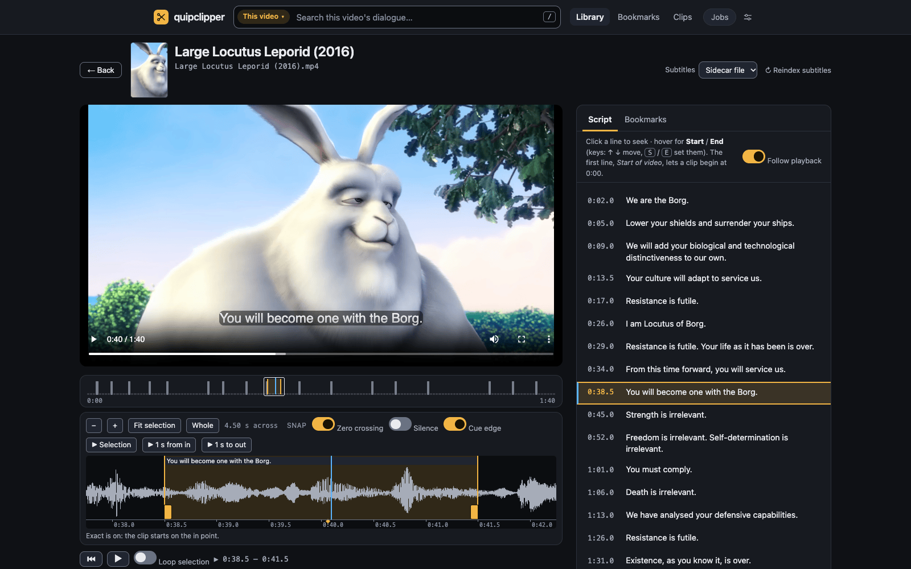
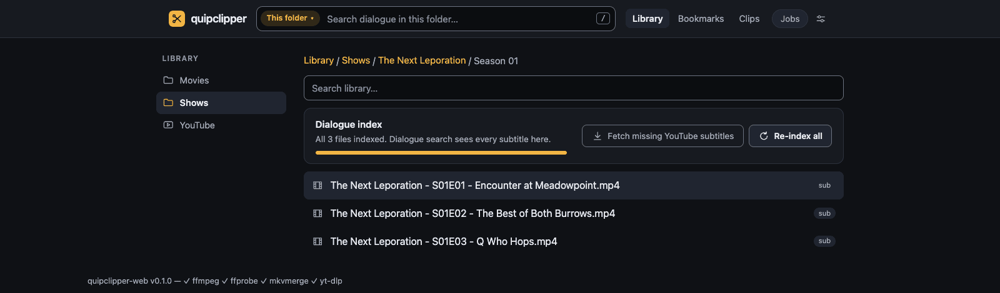
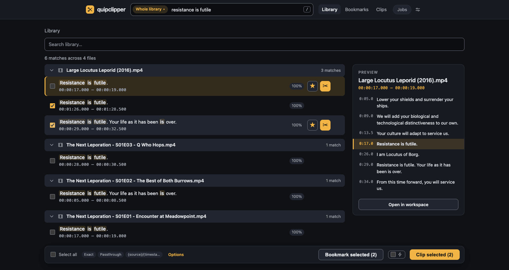
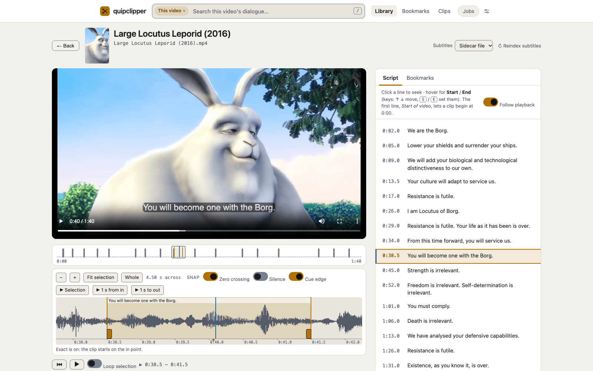
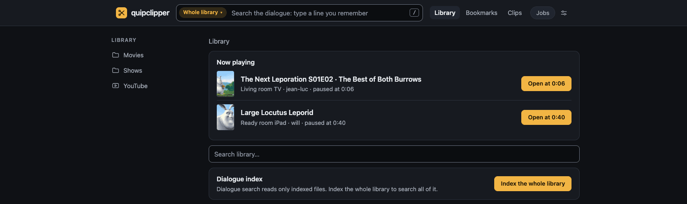
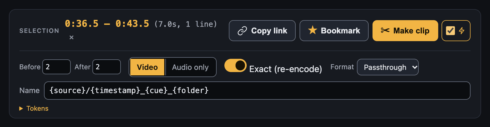
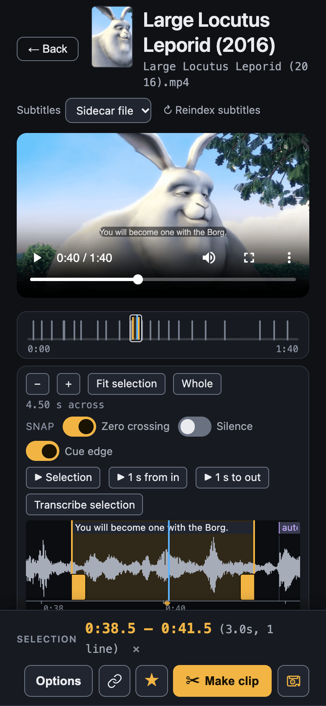

# quipclipper

[](https://github.com/weckere/quipclipper/actions/workflows/ci.yml)
[](https://github.com/weckere/quipclipper/releases)
[](LICENSE)

**Find a moment in your movies and shows by its dialogue, and cut it.** Type the line you
remember; quipclipper finds it in the subtitles, shows it on the script, and cuts the clip
(losslessly when it can) from any browser or the command line.

Subtitles already carry exact timestamps, so the trick is simple: parse the subtitles,
fuzzy-search the line, map the match back to its time span, and cut it with ffmpeg or
mkvmerge. quipclipper is a **self-hosted web app** over your own media folders, plus a
**CLI** that can do everything the web app does.



## Features

- **Dialogue search** in a video, a folder or your whole library: fuzzy and typo-tolerant,
  phrases that span several subtitles still match, results grouped by file with the words
  highlighted and a preview of the lines around each hit.
- **A workspace for each file:** the player, a dialogue map of where the talking is, and the
  scrolling script. Set the selection by whole lines (Start / End), add padding, and see it
  loop before you cut.
- **Clips that keep the source:** a lossless stream copy (every audio track, 5.1/7.1
  intact) or a frame-exact H.264 re-encode (Intel Quick Sync when present); full-mix
  WAV/FLAC; surround split into channel groups (just the centre channel, say); GIFs from
  the CLI. Clips are filed by a name template you choose.
- **Bookmarks and batches:** save lines as bookmarks, then clip or export many at once
  from search results, bookmarks or the clips library.
- **Links to every view:** each folder, search and moment has its own URL, so Back and
  Forward work (a phone's back gesture too) and **Copy link** shares a line, e.g.
  `…/#/item?path=/media/Movies/T2.mkv&t=3621.2&sel=3621.2-3624.8`. The format is in
  [docs/API.md](docs/API.md#deep-links); `item.link` prints one from the CLI.
- **Plays anything:** files the browser can't play are converted on the fly (audio, or the
  video too), and iOS gets an HLS stream.
- **[Send to LeadStinger](#leadstinger):** hand a line straight to the LeadStinger
  soundboard as a trimmed tile, or many lines as a set.
- **[Jellyfin Now playing](#jellyfin-now-playing):** open whatever a Jellyfin client is
  playing at its playhead, with the line just heard selected.
- **[Accessible](#accessibility):** hover text and screen-reader names on every control,
  full keyboard use, subtitle size options, AA contrast in dark and light, a phone layout.
- **A CLI and an HTTP API** for scripts and agents: every web action is a CLI command
  ([docs/CLI.md](docs/CLI.md)) and an API call ([docs/API.md](docs/API.md)).
- **More sources (experimental):** YouTube videos by URL (via yt-dlp), podcasts and
  audiobooks with a transcript, and EPUB3 read-along audiobooks.

## Screenshots

**The library:** the media roots on the left, and a Dialogue index card that caches
subtitles so dialogue search is instant.



**Dialogue search** over the whole library: grouped by file, the words highlighted, a
preview of the lines around a hit, and a batch bar for the ticked lines.



**The workspace** in the light theme (the dark one is at the top).



**Now playing** from Jellyfin: open what a client is playing, at its playhead.



**Send to LeadStinger:** the ⚡ toggle beside Make clip sends the line to LeadStinger
instead of the clips library.



**On a phone**, the selection stays pinned to the bottom of the screen.

<p align="center"></p>

## Install

quipclipper needs `ffmpeg` and `ffprobe`; `mkvmerge` (MKVToolNix) is used when present.
The Docker images and the Nix packages include them. Releases are listed in
[CHANGELOG.md](CHANGELOG.md) and on the [releases page](https://github.com/weckere/quipclipper/releases).

### Docker (GHCR images)

Each release publishes two images, `ghcr.io/weckere/quipclipper-app` (the backend) and
`ghcr.io/weckere/quipclipper-web` (nginx and the UI), tagged with the version (e.g.
`0.2.0`), the series (`0.2`) and `latest`. Copy
[`docker-compose.example.yml`](docker-compose.example.yml), set your media paths, and:

```bash
docker compose up -d
```

Then browse to `http://localhost:8896`. [docs/DEPLOY.md](docs/DEPLOY.md) has a minimal
compose file, every setting (`QC_MEDIA_ROOTS`, the password gate, the API token, hardware
transcoding, LeadStinger and Jellyfin), and building from source.

### NixOS module

```nix
# flake.nix
inputs.quipclipper.url = "github:weckere/quipclipper";   # main = the latest release

# a NixOS module, with quipclipper.nixosModules.default imported
services.quipclipper-web = {
  enable = true;
  mediaRoots = [ "/srv/media/movies" "/srv/media/tv" ];
  openFirewall = true;   # then browse to http://<host>/
};
```

It runs the backend as a hardened systemd service behind the host's nginx, and a NixOS VM
test in CI covers it. The options (password, API token, a shared clips folder, Quick
Sync, your own front proxy, Jellyfin, LeadStinger) are in
[docs/DEPLOY.md](docs/DEPLOY.md#nixos-module).

### The CLI on its own

```bash
pip install "git+https://github.com/weckere/quipclipper@main"   # main: the latest release
# or with Nix: nix run github:weckere/quipclipper -- --help
```

## The CLI

On local files, `search`, `clip` and `tracks` need no server:

```bash
quipclipper search "resistance is futile" --video "Large Locutus Leporid (2016).mp4"
quipclipper clip "you will become one with the borg" -v "Large Locutus Leporid (2016).mp4" -t audio
quipclipper clip "we are the borg" -v movie.mkv --split-channels --split-groups center
```

Point it at a server (`QC_URL` and `QC_API_TOKEN`, or `--server`) and every web action is
a command: browse, search folders, bookmark, batch, follow jobs, download.

```bash
quipclipper ls /movies
quipclipper search.folder "resistance is futile" --path /shows
quipclipper --json bookmark.list | quipclipper clip.batch --kind audio --out-dir ~/clips
```

`--json` gives machine output and `--safe` refuses anything destructive (for agents).
[docs/CLI.md](docs/CLI.md) lists all the commands; [docs/MANUAL.md](docs/MANUAL.md)
covers local cutting in depth (lossless copies, mkvmerge, audio tracks, surround split,
subtitles in clips).

## The HTTP API

The web UI is a thin layer over a plain HTTP+JSON API, and the API is meant to be used:
browse, search dialogue, cut clips, poll the job and download the result from a script,
a cron job or an AI agent. One `QC_API_TOKEN` gets a client through the password gate
(`curl -u api:<token>`), and your instance serves its own OpenAPI docs at `/docs`.
[docs/API.md](docs/API.md) documents every endpoint, with a worked find-a-line-and-cut-it
example.

## Integrations

### LeadStinger

[LeadStinger](https://github.com/weckere/leadstinger) is a soundboard for live shows.
Tick the **Send to LeadStinger** toggle (⚡) beside Make clip, or beside Clip / Export
selected, and the line goes straight into LeadStinger as a new tile: quipclipper cuts it
as a full-mix FLAC with its padding kept as handles, and the tile's trim sits exactly on
the line, so it can still be nudged there. Several lines at once make a LeadStinger set
file. It needs the server's public address (`QC_PUBLIC_URL`) and LeadStinger connected
once with the API token; from the CLI it is `leadstinger.quip`, `leadstinger.link`,
`leadstinger.set` and `leadstinger.send`. Setup and the link format:
[docs/MANUAL.md](docs/MANUAL.md#sending-clips-to-leadstinger).

### Jellyfin Now playing

Watching something on Jellyfin and hear a line worth keeping? With `QC_JELLYFIN_URL` and
an API key set, a **Now playing** card on the library lists what each client is playing,
and **Open at 12:34** opens the file in the workspace with the line just heard selected:
nothing to search for. Jellyfin's posters show on the library and in the workspace, clip
names can use the episode's real title (`{show}/S{season}E{episode}_{title}`), and new
clips are scanned into a Jellyfin clips library so they show up on the TV. quipclipper
still reads and cuts the media from its own folders. From the CLI: `quipclipper
nowplaying`, `quipclipper clip.nowplaying -t audio` and `quipclipper jellyfin.lookup PATH`.
Setup and path mapping: [docs/MANUAL.md](docs/MANUAL.md#now-playing-jellyfin).

## Accessibility

The web app aims at WCAG 2.2 AA, and tests keep it there:

- every control has hover text (what it does, and its shortcut) and a name a screen reader
  can say; a skip link jumps past the top bar;
- the keyboard does everything: `/` to search, Space or K to play, the script as one tab
  stop (↑ ↓ to move, Enter to play, S and E to set the selection), arrow keys on the
  dialogue map and seek bar;
- finished and failed jobs, the selection and match counts are announced;
- Settings has subtitle size (Normal, Large, Extra large) and a solid subtitle background;
  both themes meet AA contrast (a test checks every colour pair), with a stronger palette
  under `prefers-contrast: more`; pages reflow down to 320 px wide.

Details: [docs/MANUAL.md](docs/MANUAL.md#keyboard-screen-readers-and-low-vision).

## Experimental sources

- **YouTube:** paste a URL and quipclipper fetches the transcript and details with yt-dlp
  (nothing is downloaded unless you ask); search, bookmark and clip it like a file. It can
  also backfill transcripts for YouTube videos already in your library.
- **Podcasts and audiobooks:** an audio file with a sidecar transcript (`.srt`, `.vtt`,
  `.ass`, or Podcast Namespace / Whisper `.json`) is a source like any other, with speaker
  names picked up from the transcript.
- **EPUB3 read-along audiobooks** (such as [Storyteller](https://gitlab.com/storyteller-platform/storyteller)
  output): a book browses like a folder of chapters, and a line is cut straight from the
  embedded narration.

See [docs/MANUAL.md](docs/MANUAL.md#youtube-sources-experimental) and
[EPUB3 audiobooks](docs/MANUAL.md#epub3-audiobooks-experimental).

## Documentation

| | |
|---|---|
| [docs/MANUAL.md](docs/MANUAL.md) | The user manual: the web app's screens, the CLI on local files, and the topics they share. |
| [docs/DEPLOY.md](docs/DEPLOY.md) | Docker Compose, every setting, the NixOS module, versions and upgrades. |
| [docs/CLI.md](docs/CLI.md) | Every CLI command (generated from the command registry). |
| [docs/API.md](docs/API.md) | The HTTP API. |
| [docs/DESIGN_NOTES.md](docs/DESIGN_NOTES.md) | Why it is built the way it is. |
| [CHANGELOG.md](CHANGELOG.md) | What changed in each release. |

## Development

```bash
pip install -e ".[dev]" -e "web/backend[dev]"
pytest -q                              # the engine and the CLI
(cd web/backend && pytest -q)          # the web app, CLI parity and the frontend guards
nix develop                            # or a shell with everything, including ffmpeg
```

Work happens on the `dev` branch; `main` is always the latest release. Each change that
users would notice adds a line to the Unreleased section of [CHANGELOG.md](CHANGELOG.md).
`scripts/release.sh X.Y.Z` cuts a release: it bumps the version (only the two
`pyproject.toml` files hold it; the backend's is a checked copy), dates the changelog, tags `vX.Y.Z` and moves `main`; the tag's workflow runs the
tests, publishes the images and creates the GitHub Release. Every new web UI action needs a
CLI command in `src/quipclipper/commands.py`: a parity test fails until it has one.

## Licence and credits

quipclipper is released under the [MIT licence](LICENSE).

The screenshots use **"Large Locutus Leporid (2016)"**, a fixture cut from
[*Big Buck Bunny*](https://peach.blender.org/) (© 2008 Blender Foundation,
www.bigbuckbunny.org), licensed [CC BY 3.0](https://creativecommons.org/licenses/by/3.0/).
Its subtitles quote a few Borg lines from *Star Trek: The Next Generation* for search to
find; Star Trek is a trademark of CBS Studios, and quipclipper has nothing to do with it.
How the fixture and the screenshots are made:
[docs/screenshots/fixture](docs/screenshots/fixture/README.md).
